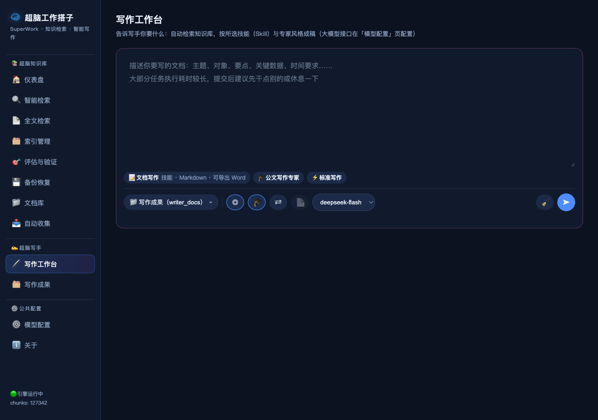
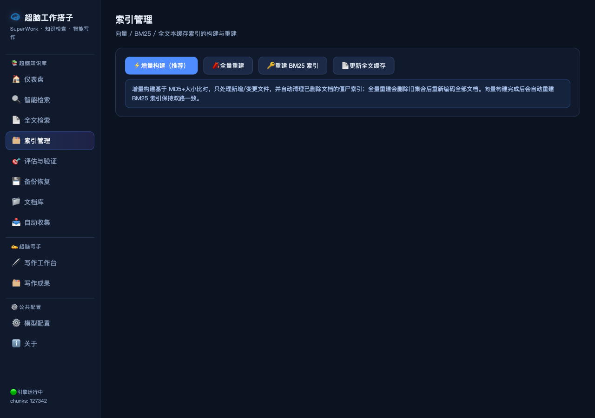

# SuperWork · 超脑工作搭子

[](https://github.com/dami-drdomain/superwork)
[](LICENSE)
[](https://github.com/dami-drdomain/superwork)
[](requirements.txt)

> A fully offline, privacy-first local RAG knowledge base and AI writing workbench for macOS.
> 本地离线、数据不出本机的 RAG 知识库 + 智能写作工作台。

SuperWork keeps your documents **on your machine**. All parsing, chunking, embedding, indexing, hybrid retrieval, and reranking run locally; the writing LLM endpoint is the only external service you configure — your API key is stored locally and used only for your own writing calls.

| Writing Workbench (Skill × Expert × Workflow) | Index Management |
|:---:|:---:|
|  |  |

## Why SuperWork

- **100% local retrieval** — vector (Chroma) + BM25 dual-channel recall, RRF fusion, three-tier reranking (skip / lightweight / cross-encoder), query rewriting with synonyms, and context assembly. No document ever leaves your machine; the service binds to `127.0.0.1` only.
- **Freshness-aware ranking** (V1.8.5) — a soft time weight (half-life 180 days) breaks ties toward the newest version of the same knowledge point, and writer material lines carry "Updated: YYYY-MM-DD" labels with explicit conflict rules, so generated documents cite current data.
- **Grounded writing with revisions** (V1.8.4) — the Writer retrieves knowledge-base materials by topic, streams a draft, then lets you revise it with free-form feedback in chained rounds; Word template imitation clones the sample document's layout paragraph-by-paragraph.
- **Three-layer skill system** (V1.8.0) — 5 built-in factory skills (editable via local overrides), your own custom skills, and imported skill snapshots; any skill can be assigned Markdown / HTML / PPT / Excel output, with format contracts appended by the engine.
- **Native, editable deliverables** — PPT decks come from a 15-layout design engine (10 themes×5, native charts, speaker notes); Excel workbooks from a worksheet design engine (themed headers, `=SUM` formula totals, data bars, native bar charts). Real objects, never image collages.
- **Ops-grade reliability** — incremental index builds with MD5+size change detection and checkpoint resume, 4-process parallel extraction, BM25 batched rebuilds, daily verification (morning/evening/standard, 4-dimension checks + PDF reports), 7-day incremental backups, an anti-freeze monitor, and automatic document collection from WPS / Mail / WeChat / DingTalk usage records.

## Architecture

```
docs/ (11 formats) ─▶ format routing ─▶ structure-aware chunking
                         │                     (per-chunk metadata: source / mtime / build_date)
                         ▼
        ┌────────────────────────────────┐
        │  ChromaDB vectors  +  BM25      │   offline, hybrid dual-channel index
        └────────────────────────────────┘
                         │  query rewriting  →  dual recall  →  RRF fusion
                         ▼
              reranking (3 tiers) + freshness soft-weight + file-level dedup
                         │
                         ▼
   context assembly ─▶ Writer (Skill × Expert × Workflow, OpenAI-compatible LLM)
                         │
                         ▼
        Markdown → Word export · Template layout cloning
        HTML single-file · PPTX (layout engine) · XLSX (design engine)
```

Retrieval models are loaded fully offline from `models/`: embedding `BAAI/bge-base-zh-v1.5` (768-dim) and reranker `BAAI/bge-reranker-base`.

## Quick Start

**Prerequisites**: macOS 12+, Python 3.10–3.12 (3.12 tested), ≥8 GB RAM, ~5 GB disk for models and indexes.

```bash
git clone https://github.com/dami-drdomain/superwork.git rag-kb
cd rag-kb
python3.12 -m venv .venv
.venv/bin/pip install -r requirements.txt
```

**1) Download the offline models** into `models/`:

```bash
mkdir -p models
# Option A — ModelScope (fast in China)
.venv/bin/pip install modelscope
.venv/bin/modelscope download --local_dir models/bge-base-zh-v1.5 BAAI/bge-base-zh-v1.5
.venv/bin/modelscope download --local_dir models/bge-reranker-base BAAI/bge-reranker-base
# Option B — Hugging Face
# huggingface-cli download BAAI/bge-base-zh-v1.5 --local-dir models/bge-base-zh-v1.5
# huggingface-cli download BAAI/bge-reranker-base --local-dir models/bge-reranker-base
```

**2) Add documents**: put files into `docs/` (subdirectories allowed; see supported formats below), then build the index:

```bash
.venv/bin/python rag_build_embedding.py      # incremental build (checkpoint-resumable)
.venv/bin/python rag_build_bm25.py           # BM25 rebuild (auto-run after vector builds)
```

**3) Launch** — GUI app (pywebview window with the full UI) or headless API service:

```bash
.venv/bin/python rag_app.py                          # desktop app (all features)
nohup .venv/bin/python rag_server.py > server.log 2>&1 &   # headless API on 127.0.0.1:18800
```

**4) Configure the Writer LLM (optional but recommended)**: create `llm_config.json` with any OpenAI-compatible endpoint (DeepSeek, Qwen, Kimi, Ctelecom Cloud Xirang, local Ollama…). Without it, all knowledge-base features still work; see [USER_GUIDE_EN.md](USER_GUIDE_EN.md#-model-configuration-common-configuration) for the schema.

> The macOS app bundle (`超脑工作搭子.app`) is generated by the author's release packaging and is not tracked in this repository; launching `rag_app.py` runs the identical codebase.

## Supported Document Formats (11)

`docx` · `doc` · `pdf` · `xlsx` · `xls` · `pptx` · `md` · `txt` · `csv` · `html` · `htm` — limit 20 MB per file (PPT/PPTX up to 200 MB).

## Project Structure

```
rag-kb/
├── docs/                    # your corpus (git-ignored) — put documents here
│   └── .rag_db_embed/       # vector store + indexes (auto-generated)
├── models/                  # offline embedding / reranker models (git-ignored)
├── app/index.html           # the entire GUI (single-file frontend)
├── rag_core.py              # core: format routing / noise cleaning / structure-aware chunking
├── rag_engine.py            # retrieval: rewriting / RRF / 3-tier rerank / context assembly / freshness weight
├── rag_writer.py            # writer: LLM access / skills / streaming / revision mode / Word export
├── rag_app.py               # desktop app entry (pywebview + FastAPI)
├── rag_server.py            # headless API service (127.0.0.1:18800)
├── rag_build_embedding.py   # incremental vector index builder (4-process parallel)
├── rag_build_bm25.py        # BM25 builder (batched)
├── rag_autocollect.py       # auto-collection from app-usage records (WPS/Mail/WeChat/DingTalk)
├── rag_verify.py            # daily verification (4-dimension checks + PDF reports)
├── rag_backup.py            # incremental backup & restore (7-day retention)
├── app_monitor.py           # independent anti-freeze monitor
├── rag_watchdog.py          # service daemon (probes / auto-restart)
├── build_text_cache.py      # full-text cache search (keyword / regex / grep)
├── daily_ops.sh             # daily automation (nightly builds, morning/evening checks)
└── requirements.txt
```

## Documentation

- 🇨🇳 [使用说明.md](使用说明.md) — full user guide in Chinese (all 33 version notes)
- 🇬🇧 [USER_GUIDE_EN.md](USER_GUIDE_EN.md) — English user guide
- 🇬🇧 [ABOUT_EN.md](ABOUT_EN.md) — English "About" page content

## Privacy Principles

1. **On-device only** — parsing, indexing, embedding, and retrieval run locally; nothing is uploaded.
2. **Loopback-bound service** — the HTTP API and UI are served on `127.0.0.1:18800`, unreachable from the network.
3. **User-owned keys** — the writing LLM endpoint and key live in the local `llm_config.json` (git-ignored) and are sent only to the LLM service you configure.
4. **Auditable, killable retrieval** — every retrieval channel can be inspected and disabled at any time.

## Recent Highlights

- **V1.8.5** — freshness-soft-weighted retrieval + writer date pass-through ("latest content first")
- **V1.8.4** — chained revision mode for the writing workbench
- **V1.8.3** — Word template layout cloning (paragraph-level format sampling)
- **V1.8.0** — three-layer skill library with assignable output types
- **V1.7.2 / V1.7.0** — Excel design engine / PPT design system + layout engine

Full changelog (33 versions, V1.5.5 → V1.8.5): [使用说明.md](使用说明.md) · [USER_GUIDE_EN.md](USER_GUIDE_EN.md)

## License

This project is licensed under the [GNU General Public License v3.0](LICENSE) — you are free to use, study, modify, and redistribute it, provided derivatives are distributed under the same license and carry the source.

As the copyright holder, the author retains the right to offer alternative commercial licensing.

## Author

**Dami (大米)** — building agent/RAG products for government and enterprise scenarios.

> AI生成
